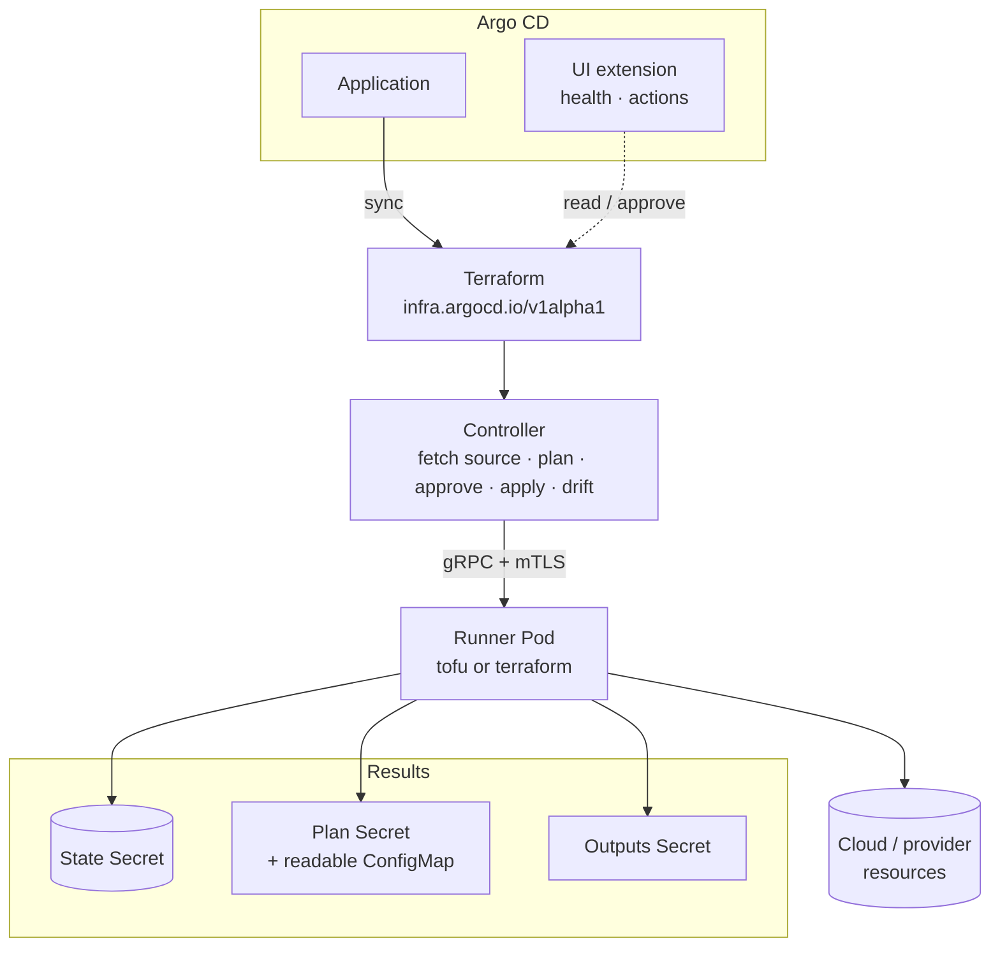

# Argo CD Terraform Controller

Run Terraform and OpenTofu from Argo CD, GitOps style, with plan approval, drift
detection and a UI extension. It is an **add-on**: no changes to Argo CD are
required. The design follows the Flux [tofu-controller](https://github.com/flux-iac/tofu-controller).

**Documentation:** <https://redhat-developer.github.io/argocd-terraform-controller/>



## Features

- **Terraform object** (`infra.argocd.io/v1alpha1`) describing a Git or OCI source,
  variables, backend, approval mode, outputs and health checks. Argo CD syncs the
  object; the controller does the rest.
- **Terraform and OpenTofu** in one runner image; choose per object with
  `spec.runner.binary: auto | terraform | tofu`.
- **Plan / approve / apply** with manual approval by plan ID (from git, `kubectl`
  or the Argo CD UI), `auto` approval, plan-only and drift-detection-only modes.
- **Drift detection** on every interval, with automatic remediation in `auto` mode.
- **State** in a Kubernetes Secret through Terraform's `kubernetes` backend by
  default, or any other backend (`s3`, `gcs`, `azurerm`, …) and Terraform Cloud.
- **Outputs to a Secret**, health checks, `dependsOn` between stacks, destroy on
  deletion (optionally deleting the state too), state force-unlock.
- **Argo CD integration** through supported extension points only: health
  assessment and resource actions in `argocd-cm`, and a UI extension adding a
  **Terraform** sidebar dashboard — every Terraform object across your
  Applications, with a graph of what each one manages (Kubernetes or not: VPCs,
  buckets, databases…), plan output and an approve button — plus a resource
  tab, an Application details tab and an application view.
- **Isolation**: the controller holds source credentials and talks to a
  per-object runner Pod over mTLS; the runner only executes the binary with its
  own ServiceAccount.

## Quick start

The step-by-step, copy-and-paste version is in [docs/getting-started.md](docs/getting-started.md).

Install the controller, the runner identity for your namespaces, and the
Argo CD integration (health, actions, UI extension) with one Helm command.
The chart checks that Argo CD is present (`argocd` namespace by default;
`--set argocd.namespace=…` otherwise) and `helm uninstall` reverts the Argo CD
changes:

```sh
helm install argocd-terraform-controller \
  oci://quay.io/redhatworkshops/argocd-terraform-controller-helmchart --version <version> \
  --namespace argocd-terraform-controller-system --create-namespace \
  --set runner.namespaces="{my-namespace}" --wait
```

Plain-manifest alternatives (`install.yaml`, `argocd-cm-patch.yaml`,
`argocd-server-extension-patch.yaml`) are attached to every release — see
[Installation](docs/operator-manual/installation.md).

Then put a Terraform object in a repository synced by an Argo CD Application:

```yaml
apiVersion: infra.argocd.io/v1alpha1
kind: Terraform
metadata:
  name: network
  namespace: my-namespace
spec:
  source:
    git:
      url: https://github.com/my-org/infra
      ref:
        branch: main
  path: ./network
  interval: 10m
  approvePlan: ""          # manual: approve in the UI or set the plan ID here
  runner:
    binary: tofu
  writeOutputsToSecret:
    name: network-outputs
```

The Application shows the object as *Suspended* while a plan waits for approval,
*Progressing* while applying and *Healthy* once applied, so later sync waves can
depend on the infrastructure. The **Terraform** entry in the Argo CD sidebar
lists every object and graphs the resources it manages.

## Documentation

Full documentation is at <https://redhat-developer.github.io/argocd-terraform-controller/>
(sources in [`docs/`](docs/)).

- [Getting started](https://redhat-developer.github.io/argocd-terraform-controller/getting-started/)
- [Operator Manual](https://redhat-developer.github.io/argocd-terraform-controller/operator-manual/) — installation and upgrades, Argo CD integration, state backends, Terraform vs OpenTofu
- [User Guide](https://redhat-developer.github.io/argocd-terraform-controller/user-guide/) — plan approval, sources, variables and credentials, specification reference
- [Developer Guide](https://redhat-developer.github.io/argocd-terraform-controller/developer-guide/)
- The generated CRD schema is also browsable at [doc.crds.dev](https://doc.crds.dev/github.com/redhat-developer/argocd-terraform-controller)

## Status

Alpha. The API group `infra.argocd.io/v1alpha1` may change before v1.

## License

Apache-2.0. Copyright The Argo CD Terraform Controller Authors.

Portions of this software are derived from the Flux IaC
[tofu-controller](https://github.com/flux-iac/tofu-controller), originally
created by Weaveworks Ltd. and the Flux IaC contributors, licensed under the
Apache License, Version 2.0.
