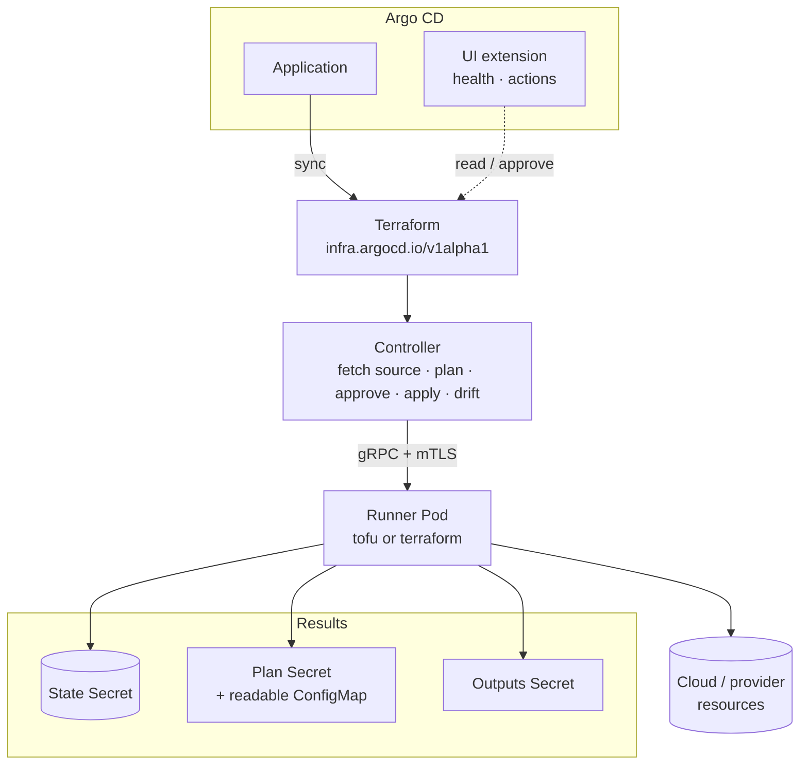

# Overview

**Argo CD Terraform Controller** runs Terraform and OpenTofu from Argo CD, GitOps
style, with plan approval, drift detection and a UI extension. It is an
**add-on**: no changes to Argo CD are required.

A `Terraform` object (`infra.argocd.io/v1alpha1`) describes a Git or OCI
source, variables, backend, approval mode and outputs. Argo CD syncs the object
like any other manifest; the controller fetches the source, plans, waits for
approval when asked to, applies, detects drift and writes outputs. Argo CD
shows the result through its normal health model, resource actions and a
**Terraform** entry in the sidebar.

## Features

- **Terraform object** describing a Git or OCI source, variables, backend,
  approval mode, outputs and health checks. Argo CD syncs the object; the
  controller does the rest.
- **Terraform and OpenTofu** in one runner image; choose per object with
  `spec.runner.binary: auto | terraform | tofu`.
- **Plan / approve / apply** with manual approval by plan ID (from Git,
  `kubectl` or the Argo CD UI), `auto` approval, plan-only and
  drift-detection-only modes.
- **Drift detection** on every interval, with automatic remediation in `auto`
  mode.
- **State** in a Kubernetes Secret through Terraform's `kubernetes` backend by
  default, or any other backend (`s3`, `gcs`, `azurerm`, …) and Terraform Cloud.
- **Outputs to a Secret**, health checks, `dependsOn` between stacks, destroy
  on deletion (optionally deleting the state too), state force-unlock.
- **Argo CD integration** through supported extension points only: health
  assessment and resource actions in `argocd-cm`, and a UI extension adding a
  **Terraform** sidebar dashboard — every Terraform object across your
  Applications, with a graph of what each one manages (Kubernetes or not: VPCs,
  buckets, databases…), plan output and an approve button — plus a resource
  tab, an Application details tab and an application view.
- **Isolation**: the controller holds source credentials and talks to a
  per-object runner Pod over mTLS; the runner only executes the binary with its
  own ServiceAccount.

## Where to go next

- New here? Follow the [Getting started](getting-started.md) walkthrough: it
  installs everything on a cluster that already runs Argo CD and takes a sample
  through plan, approval and apply.
- Running it for a team? The [Operator Manual](operator-manual/index.md)
  covers installation and upgrades, the Argo CD integration, state backends and
  the Terraform/OpenTofu runner.
- Writing Terraform objects? The [User Guide](user-guide/index.md) explains the
  approval workflow, sources, variables and credentials, drift detection,
  outputs, dependencies and destroy semantics, with
  [complete examples](user-guide/examples.md) and the full
  [specification reference](user-guide/api.md).
- Something off? [Troubleshooting](operator-manual/troubleshooting.md) and the
  [FAQ](faq.md).
- Contributing? See the [Developer Guide](developer-guide/index.md).

## Status

Alpha. The API group `infra.argocd.io/v1alpha1` may change before v1.
Releases, images and Helm charts are published from the
[GitHub repository](https://github.com/redhat-developer/argocd-terraform-controller/releases).
