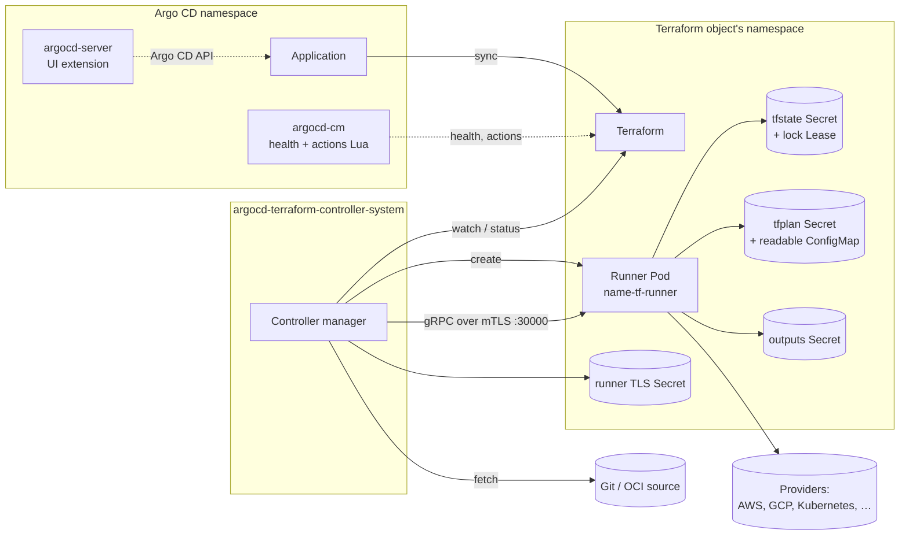

# Architecture

The controller turns a `Terraform` object into Terraform or OpenTofu runs
executed in a short-lived **runner Pod**, and reports the result back through
the object's status so that Argo CD can display it like any other resource.

## Components

| Component | Runs where | Role |
|---|---|---|
| **Controller manager** (`cmd/manager`) | Deployment in `argocd-terraform-controller-system`, one leader | Watches `Terraform` objects; resolves and fetches sources; creates runner Pods; drives them over gRPC; writes status, conditions and events; owns the mTLS CA |
| **Runner** (`cmd/runner`) | One Pod per Terraform object, in the object's namespace, only for the duration of a run | Receives the source archive, generates backend/variables files, executes `terraform`/`tofu` through `terraform-exec`, stores plans and outputs as Secrets/ConfigMaps using its own ServiceAccount (`tf-runner`) |
| **Argo CD customizations** (`config/argocd`) | `argocd-cm` and an init container on `argocd-server` | Health assessment, resource actions (approve, re-plan, suspend, resume, force-unlock) and the UI extension; see [Argo CD integration](argocd-integration.md) |

Only the controller has credentials to read sources; only the runner has
permissions in the object's namespace. The two meet over a per-namespace
mutual-TLS gRPC connection.

## A reconciliation, step by step

1. **Trigger.** The object was created or changed (a new `metadata.generation`),
   `spec.interval` elapsed, the `infra.argocd.io/reconcile` annotation was set,
   or a previous run asked for a retry. Status-only updates do not trigger runs.
2. **Dependencies.** If `spec.dependsOn` is set, every dependency must be
   Ready at its current generation (and, for the same source, at the same
   revision); otherwise the object is `Progressing/DependencyNotReady` and is
   retried. A finalizer is added to each dependency so it cannot be deleted
   first.
3. **Source.** The controller resolves the revision (`git ls-remote`, or the OCI
   manifest digest). If it changed since the last run, the tree is fetched,
   filtered by `ignore`, and archived. Argo CD repository credentials can be
   reused ([Sources](../user-guide/sources.md)).
4. **Runner.** A Pod `<name>-tf-runner` is created in the object's namespace
   from `spec.runner` (image, ServiceAccount, `podTemplate`) with a mounted
   server certificate issued by the controller's CA. The controller waits for
   it to become ready (`--runner-creation-timeout`) and dials it by Pod IP.
5. **Setup.** The archive is uploaded; the runner writes `backend_override.tf`
   (the Kubernetes backend by default, see [State](state.md)),
   `generated.auto.tfvars.json` from `spec.vars`/`varsFrom`/`values`, any
   `spec.fileMappings`, and the `.tfrc` from `cliConfigSecretRef`; then runs
   `init` (with `-upgrade` and `-force-copy`) and selects the workspace.
6. **Drift detection.** When nothing changed since the last apply, a
   refresh-only plan checks the real infrastructure against the state. No
   drift → done (`Ready/NoDrift`). Drift → `DriftDetected`; in `auto` mode the
   run continues to re-plan and apply, otherwise it stops and reports.
   See [Drift detection](../user-guide/drift-detection.md).
7. **Plan.** `plan -out` produces a binary plan stored in Secret
   `tfplan-<workspace>-<name>` and a human-readable copy in ConfigMap
   `tfplan-<workspace>-<name>-readable`. The plan ID (`plan-<ref>-<sha>`) goes
   to `status.plan.pending`. Without approval the run stops here; Argo CD shows
   **Suspended**. See [Plan approval](../user-guide/approval-workflow.md).
8. **Apply.** With `approvePlan: auto`, `spec.force`, or a matching plan ID
   the controller re-plans once more (to make sure the approved plan is still
   current) and applies. Failures set `Ready=False` with a `TFExec*` reason and
   schedule a retry.
9. **Outputs, inventory, health checks.** Outputs are written to
   `spec.writeOutputsToSecret`, the list of managed resources is recorded in
   `status.inventory`, and `spec.healthChecks` run against the outputs.
   See [Outputs](../user-guide/outputs.md) and
   [Dependencies and health checks](../user-guide/dependencies-and-health-checks.md).
10. **Cleanup.** The working directory is removed, the runner Pod is deleted
    (`spec.runner.alwaysCleanup`, default) and the object is requeued after
    `spec.interval`.

Deletion follows the same path through a finalizer: with
`spec.destroyResourcesOnDeletion` a destroy plan is applied first; plan and
output objects are removed; the state Secret is kept unless
`spec.tfstate.deleteOnDestroy` is set. See
[Destroy and deletion](../user-guide/destroy-and-deletion.md).

## Status model

The object carries standard `metav1.Condition`s. `Ready` is the one Argo CD's
health check reads:

| `Ready` | Reason (examples) | Meaning | Argo CD health |
|---|---|---|---|
| `True` | `TerraformAppliedSucceed`, `NoDrift`, `TerraformOutputsWritten`, `HealthChecksSucceeded`, `TerraformPlannedNoChanges` | Last run succeeded and the infrastructure matches | Healthy |
| `Unknown` | `Progressing`, `TerraformPlannedWithChanges`, `DependencyNotReady` | Working, or waiting for a human | Progressing, or **Suspended** when a plan awaits approval |
| `False` | `TFExecPlanFailed`, `TFExecApplyFailed`, `SourceFetchFailed`, `LockHeld`, `DriftDetected`, `HealthChecksFailed`, `RetryLimitReached`, `AccessDenied` | Something needs attention | Degraded |
| any | `Suspended` | `spec.suspend: true` | Suspended |

Additional conditions (`Plan`, `Apply`, `Output`, `HealthCheck`, `StateLocked`,
`Reconciling`, `Stalled`) record the last result of each phase. Events with the
same reasons are emitted on the object; the Argo CD UI shows them under the
Terraform tab and in the dashboard. The full list is in the
[specification reference](../user-guide/api.md#status).

## Isolation model

- **Credentials split.** Source credentials (Git/OCI, including Argo CD's) are
  read by the controller and never reach the runner; the runner receives a
  tarball. Provider credentials given through `env`/`envFrom` or workload
  identity reach the runner only; `fileMappings` content is read by the
  controller and forwarded over the mTLS channel
  ([Variables and credentials](../user-guide/variables-and-credentials.md)).
  The controller itself never holds a cloud identity or runs the binary.
- **Per-namespace runners.** A runner runs as the `tf-runner` ServiceAccount of
  the object's namespace with a Role limited to Secrets, ConfigMaps and
  Leases there. Different teams' namespaces get different identities, and
  cloud permissions can be bound per namespace (or per object with
  `spec.runner.serviceAccountName`).
- **mTLS.** The controller runs a CA (rotated, `--ca-validity-duration`) and
  issues a server certificate per namespace (`terraform-runner.tls` Secret).
  The runner only accepts the controller's client certificate; nothing else can
  instruct it.
- **Hardened Pods.** Manager and runner run as non-root with a read-only root
  filesystem, all capabilities dropped and a `RuntimeDefault` seccomp profile.
  The runner's `/tmp` and `/home/runner` are `emptyDir`s that die with the Pod.
- **No Argo CD privileges.** The UI extension uses the logged-in user's Argo CD
  session and RBAC; the controller only needs read access to Argo CD's
  repository Secrets, and only if that feature is enabled.

See [Security](security.md) for the operator's checklist.

## Repository map

For contributors, the code follows the component split above:

| Path | Contents |
|---|---|
| `api/v1alpha1` | `Terraform` types, condition helpers, naming helpers (`StateSecretName`, `RunnerPodName`) |
| `internal/controller` | Reconciler: setup, drift, plan, apply, outputs, finalizer, runner Pod management |
| `internal/runner` | gRPC server executed inside the runner image (`runner.proto`) |
| `internal/mtls` | CA and certificate rotation |
| `internal/source` | Git and OCI fetchers, Argo CD credential lookup |
| `internal/plan`, `internal/tarball` | Plan Secret chunking, source archives |
| `config/` | Kustomize: CRD, RBAC, manager, runner identity, Argo CD component, samples |
| `charts/` | Helm chart |
| `ui/extension` | Argo CD UI extension (TypeScript/React) |

More in the [Developer Guide](../developer-guide/index.md).
