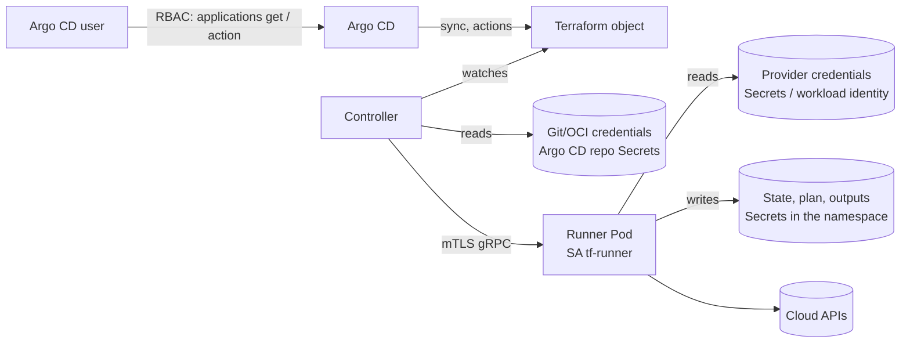

# Security

Terraform can create anything its credentials allow, and its state contains
every attribute of every resource it manages. This page lists what the
controller does to contain that, and what is left for you to decide.

## Trust boundaries



| Who | Can | Cannot |
|---|---|---|
| **Argo CD user** | See Terraform objects of Applications they can `get`; run actions they are granted (`action/infra.argocd.io/Terraform/<action>`) | Read Secret data (Argo CD redacts it), reach the controller or the runner |
| **Controller** | Read `Terraform` objects cluster-wide, write their status; read Secrets/ConfigMaps in any namespace (source credentials, `fileMappings`, `cliConfigSecretRef`); create/delete runner Pods and TLS Secrets; read Argo CD repo Secrets *if enabled* | Execute Terraform, hold cloud identity, write state — it has no provider credentials of its own and never runs the binary |
| **Runner** | Everything `tf-runner` in its namespace may do: Secrets, ConfigMaps, Leases (state, plans, outputs); plus whatever cloud identity you give it (env, files, workload identity) | Anything in other namespaces; reach sources; accept instructions from anyone but the controller (mTLS) |

## Controller hardening

Shipped by default in `install.yaml` and the chart:

- Runs as non-root, read-only root filesystem (writable `emptyDir` on `/tmp`
  for Git clones), all capabilities dropped, `seccompProfile: RuntimeDefault`.
- Leader election via Leases; metrics served over HTTPS with
  authentication/authorization (`--metrics-secure`); a `NetworkPolicy` that
  only admits metrics scrapes from namespaces labelled `metrics: enabled`.
- Cluster-wide permissions: the CRD; Pods (runner lifecycle); Secrets and
  ConfigMaps (source credentials, `fileMappings`, `.tfrc`, the mTLS
  certificates it issues); Events; Leases. It is a privileged component —
  treat its namespace like Argo CD's own. Reading Argo CD's repository
  credentials additionally requires the optional RoleBinding in the Argo CD
  namespace (`argocd_repo_reader_binding.yaml`,
  `argocd.repoCredentials.enabled`), which also covers the
  `argocd-ssh-known-hosts-cm` ConfigMap.

## Runner hardening

Each run executes in a fresh Pod that is deleted afterwards
(`spec.runner.alwaysCleanup`, default). The Pod spec generated by the
controller sets: UID 65532, non-root, read-only root filesystem, all
capabilities dropped, no privilege escalation, `RuntimeDefault` seccomp,
`emptyDir` for `/tmp` and `/home/runner`. The gRPC server requires a client
certificate signed by the controller's CA; the CA rotates
(`--ca-validity-duration`, default 7 days).

You can replace the container security context through
`spec.runner.podTemplate.spec.securityContext`, but anything you set replaces
the defaults, so keep the restrictive fields. Workload-identity tokens are
readable without extra settings because every container runs as UID 65532
(see [Runner Pods › Security context](../user-guide/runner.md#security-context)).

Admission policies (Pod Security Admission `restricted`, Kyverno, Gatekeeper)
apply to runner Pods like to any other; the defaults pass the `restricted`
profile.

## Namespace isolation and tenancy

- The runner identity is **per namespace**: `tf-runner` plus a RoleBinding to
  `argocd-terraform-controller-runner-role`. A namespace without it cannot run
  Terraform. Teams therefore cannot read each other's state or outputs through
  the controller.
- Cloud permissions follow the ServiceAccount (workload identity) or the
  Secrets in that namespace — scope them per namespace, or per object with
  `spec.runner.serviceAccountName`.
- `--no-cross-namespace-refs` (default `true`) blocks `dependsOn` and
  `cliConfigSecretRef` across namespaces; the object reports `AccessDenied`.
- `Terraform` objects are namespaced, so Argo CD AppProjects' destination and
  resource allow-lists apply as usual (`infra.argocd.io/Terraform`).

## Kubernetes RBAC for people

Three ClusterRoles ship with the install; bind them per namespace or
cluster-wide:

| ClusterRole | Grants |
|---|---|
| `argocd-terraform-controller-terraform-viewer-role` | `get`, `list`, `watch` on `terraforms` and `terraforms/status` |
| `argocd-terraform-controller-terraform-editor-role` | viewer + `create`, `update`, `patch`, `delete` |
| `argocd-terraform-controller-terraform-admin-role` | everything on `infra.argocd.io` |

Remember that `kubectl` access to Secrets in a namespace means access to the
state (and any outputs written there); treat Secret `get` in Terraform
namespaces as sensitive.

## Argo CD RBAC for people

Approving, re-planning, suspending and force-unlocking from the UI are Argo CD
**resource actions**. Grant them explicitly:

```csv
p, role:platform, applications, get, */*, allow
p, role:platform, applications, action/infra.argocd.io/Terraform/approve-plan, */*, allow
p, role:platform, applications, action/infra.argocd.io/Terraform/replan, */*, allow
p, role:platform, applications, action/infra.argocd.io/Terraform/suspend, */*, allow
p, role:platform, applications, action/infra.argocd.io/Terraform/resume, */*, allow
p, role:platform, applications, action/infra.argocd.io/Terraform/force-unlock, */*, allow
```

Users without `action/...` permissions still see everything the dashboard
shows (plans, outputs names, inventory) if they can `get` the Application. The
plan text lives in a ConfigMap precisely so that it is visible; if plans may
contain sensitive values, set `spec.storeReadablePlan: none` (the UI then
shows only the summary) and rely on Git-based approval.

## Secrets

- **State** (`tfstate-*`), **plans** (`tfplan-*`), **outputs** and **provider
  credentials** are Kubernetes Secrets. Enable
  [encryption at rest](https://kubernetes.io/docs/tasks/administer-cluster/encrypt-data/)
  and consider an external KMS provider.
- Argo CD never sees Secret *data* through its API, so nothing sensitive leaks
  into the UI or the Argo CD audit log beyond Secret names.
- For state outside the cluster (`s3`, `gcs`, `azurerm`, Terraform Cloud) the
  usual backend security applies; the controller adds nothing.
- Prefer **workload identity** over stored cloud credentials; where a Secret
  is unavoidable, use a dedicated least-privilege principal and rotate it
  (file mappings and env vars are re-read on every run). See
  [Variables and credentials](../user-guide/variables-and-credentials.md).

## Supply chain

- Images are built by GitHub Actions from tagged sources and published to
  `quay.io/redhatworkshops/argocd-terraform-controller-{manager,runner}` with
  the release version as tag; `install.yaml` and the Helm chart of a release
  pin those tags.
- The runner image downloads Terraform from `releases.hashicorp.com` with
  SHA256 verification and OpenTofu from the official `ghcr.io/opentofu`
  image; versions are build arguments (see [Terraform vs OpenTofu](binaries.md)).
- Terraform providers are downloaded by `init` inside the runner at run time
  from the public registry (or your mirror via a `.tfrc` from
  `spec.cliConfigSecretRef`). Pin provider versions in your configuration and
  consider `provider_installation` filesystem/network mirrors for air-gapped
  clusters.
- The UI extension is fetched by `argocd-extension-installer` from the GitHub
  release with checksum verification (`EXTENSION_CHECKSUM_URL`).

## Reporting a vulnerability

Please report security issues privately through
[GitHub security advisories](https://github.com/redhat-developer/argocd-terraform-controller/security/advisories/new)
rather than public issues.
