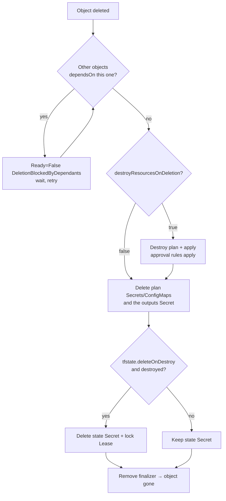

# Destroy and deletion

Terraform-managed infrastructure outlives Pods and Deployments by design, so
tearing it down is deliberate. There are two triggers — a flag on the object
and the deletion of the object — and one knob for what happens to the state.

## `spec.destroy: true` — destroy, keep the object

Sets the next plan to a **destroy plan** (`plan -destroy`) for everything in
the state. The same approval rules apply as for any other plan: in manual mode
the object becomes Suspended with the destroy plan's ID, and the UI marks it
`destroy`; `approvePlan: auto` destroys immediately.

```yaml
spec:
  destroy: true
  approvePlan: ""        # review the destroy plan, then approve it
```

After the destroy: `status.plan.lastApplied` records the destroy plan,
`status.plan.isDestroyPlan` is true, the outputs Secret is not rewritten, and
the object stays Healthy with an empty state. Drift detection is skipped while
`destroy` is set. Flip it back to `false` (or remove it) and the next plan
recreates everything — a convenient way to rebuild an environment from scratch
or to park an expensive stack over a weekend.

## Deleting the object

Deletion is handled by a finalizer, so `kubectl delete` (or an Argo CD prune)
returns immediately but the object stays `Terminating` until the controller
is done:



### Default: keep the infrastructure

Without `destroyResourcesOnDeletion`, deleting the object **does not touch the
infrastructure**. Plan and outputs objects are removed; the state Secret is
kept so that a new object with the same name (or
`backendConfig.secretSuffix`) adopts the existing resources on its next plan.
This is the safe default for production: removing a manifest from Git by
mistake does not delete a database.

### `spec.destroyResourcesOnDeletion: true` — destroy, then delete

```yaml
spec:
  destroyResourcesOnDeletion: true
  tfstate:
    deleteOnDestroy: true          # optional: remove the state Secret and lock Lease too
```

When the object is deleted the controller runs a destroy plan and applies it
**under the same approval rules**. With manual approval the object sits in
`Terminating` showing the destroy plan until someone approves it (UI action,
`kubectl patch … approvePlan`, or Git if the object still exists in Git —
which, during a prune, it does not; use `approvePlan: auto` or the UI for
objects that must self-destroy on prune).

`deleteOnDestroy` only acts after a *successful* destroy and only with the
Kubernetes backend; other backends keep their state wherever it lives.

### Ordering

- **Dependants first.** If other objects `dependsOn` this one, deletion waits
  for them (`DeletionBlockedByDependants`). See
  [Dependencies](dependencies-and-health-checks.md#deletion-protection).
- **Argo CD prune** deletes resources in reverse sync-wave order, then waits
  for finalizers. Put Terraform objects in an earlier wave than their
  consumers so the consumers are gone before the infrastructure is destroyed.
- **Uninstalling the controller** before the objects are gone leaves them in
  `Terminating` forever (nobody runs the finalizer). Delete the objects first
  and wait, or remove the finalizers by hand if the resources are already
  gone — see [Troubleshooting](../operator-manual/troubleshooting.md#helm-or-argo-cd-prune-deletes-the-object-before-the-controller-destroyed-anything).

## Choosing a policy

| Environment | Suggested settings |
|---|---|
| Production, shared infrastructure | `destroyResourcesOnDeletion: false` (default). Destroy explicitly with `spec.destroy: true` + manual approval when really intended |
| Per-team or per-PR environments created by an ApplicationSet | `destroyResourcesOnDeletion: true`, `approvePlan: auto`, `tfstate.deleteOnDestroy: true` so pruned Applications leave nothing behind |
| Expensive stacks you want to pause | keep the object, toggle `spec.destroy` |

## What a destroy will not do

- It never deletes the Terraform object's namespace, the `tf-runner`
  identity or the credentials Secrets you created.
- It cannot destroy resources that are in the state but no longer exist in
  the configuration *and* are protected by `prevent_destroy` — Terraform
  refuses, the apply fails with `TFExecDestroyFailed`, and the object stays
  `Terminating`. Remove the lifecycle rule or the resource from state first
  ([State › Working with the state from the CLI](../operator-manual/state.md#working-with-the-state-from-the-cli)).
- Resources created outside Terraform (manually, by an operator inside the
  provisioned cluster) are untouched, which can block the destroy of their
  parents (a VPC with leftover ENIs, a bucket with objects). Clean those up
  or add `force_destroy`-style attributes in the configuration.
